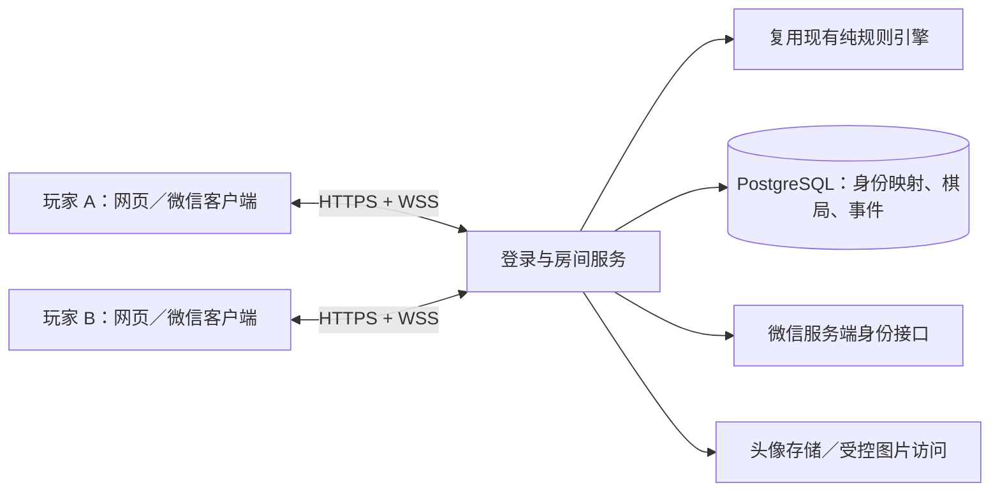

# 异地双人联机与微信接入设计 v1

日期：2026-10-19。基于 V4（`ce8c3f4`）。状态：设计稿，尚未实现或部署联网服务。第一阶段暂按“网页版先验证联机，之后接入微信客户端”设计，账号资质与首发平台待用户补充。

## 1. 用户体验与范围

目标是两位玩家分别使用自己的设备、登录各自微信账号，进入同一个私密双人房间。双方实时看到相同棋局、骰点、移动与任务。仍然轮流掷骰，并不改成同时行动。

完整流程：登录 → 选择／授权头像昵称 → 创建房间或接受邀请 → 查看对方头像并准备 → 双方准备后开局 → 两端同步掷骰和任务 → 精准到达共同爱心终点 → 保存最终约定。

- 保持 44 格、36 题、共用起点、2／4／6 起飞、奖惩 ±2 和精确到达规则。
- 房间最多两个账户，无陌生人匹配、公开旁观或聊天记录采集。
- 玩家自行通过现有通话工具交流，第一版不增加语音、视频或答案上传。
- 当前本地同屏玩法保留为独立入口；联机状态不读取或覆盖本地棋局。
- 微信真实登录需要平台账号和服务端配置；开发身份只用于本地双端测试，界面明确标为“开发测试身份”。

## 2. 平台路线与事实边界

| 平台 | 身份接入 | 头像来源 | 对现有页面的影响 |
| --- | --- | --- | --- |
| 浏览器开发版 | 仅开发环境的测试身份 | 默认头像／测试图 | 优先验证房间、同步、重连 |
| 微信内 H5 | 具备相应权限的公众号网页授权 | 该授权能力实际提供的资料或用户自行设置 | 现有 HTML/CSS 可继续使用；不能直接调用原生 `wx.login` |
| 桌面网站微信登录 | 微信开放平台网站应用登录，账号需具备对应能力 | 对应授权接口返回的资料 | 与公众号 H5 登录使用不同适配器 |
| 微信小游戏 | `wx.login`，服务端交换微信身份 | 用户信息授权按钮及已授权后的用户资料接口 | 复用规则／协议／素材；DOM/CSS 界面需适配 Canvas 等运行环境 |
| 普通微信小程序 | `wx.login`，服务端交换微信身份 | `chooseAvatar` 与昵称填写能力 | 需要 WXML/WXSS 等客户端适配，头像接口不照搬小游戏 |

这是棋盘游戏，微信端优先评估“小游戏”形态。普通小程序是否适合，应在账号后台确认类目与平台审核要求后决定；本设计不承诺上线资质或审核结果。现有 HTML 也不能直接改个文件后就作为原生微信小游戏运行。

微信登录确认身份，头像授权提供展示资料，二者是独立流程。小游戏与普通小程序的资料接口不同：小游戏官方 API 定义保留 `createUserInfoButton` 与已授权后 `getUserInfo` 的流程；小程序官方头像组件使用 `chooseAvatar`／昵称填写能力。具体基础库和授权行为在微信开发者工具及两台真机上验证后锁定。[微信官方小游戏 API 定义](https://github.com/wechat-miniprogram/minigame-api-typings/blob/master/types/wx/lib.wx.api.d.ts)、[微信官方头像昵称组件说明](https://github.com/wechat-miniprogram/mp-user-avatar)。后者已归档，仅作为接口行为参考，不作为新增依赖。

账号对接还可评估云开发认证，但云开发用户 ID 与微信 OpenID 不能混为一谈。若采用云开发，要先选定具体产品并使用其对应认证流程，不能把不同 SDK 的初始化方式拼接使用。[腾讯云开发认证说明](https://docs.cloudbase.net/authentication/auth/introduce)、[小程序接入说明](https://docs.cloudbase.net/recipes/add-auth-wechat-miniprogram)。

## 3. 系统架构

推荐第一版使用受支持的 Node.js LTS、TypeScript、HTTPS API、标准 JSON WebSocket 协议和 PostgreSQL。单服务实例先完成持久化和双端验证，规模需要时再增加多实例房间路由／消息分发；第一版不依赖 Redis 或帧同步服务。部署平台在明确域名、预算与账号后确定。



服务端是棋局的唯一权威来源。客户端仅发送“我要掷骰／完成任务／选择奖惩”等意图，不提交骰点、目标格、自己的座位或完整棋局来覆盖服务器。骰点、先手和换题由服务端使用安全随机数生成。

继续复用 `js/engine.js` 的 CommonJS 导出和 `js/board-data.js`；初期不移动旧文件。服务端将已验证的命令转换为 `engine.reduce()` 动作。客户端接收引擎事件播放动画，使用服务器快照绘制最终状态。

## 4. 身份与登录设计

业务账户使用随机 `userId`。微信身份映射以 `(provider, appId, openId)` 唯一；UnionID 存在时作为跨应用关联辅助信息，不假定它一定返回，不直接用昵称或头像识别账户。跨公众号／小游戏合并账户必须经过有效登录验证，不仅凭前端传来的 UnionID 合并。

微信原生端：

1. 用户进入登录流程，客户端调用 `wx.login` 获得临时 code。
2. 客户端将 code 发往 `POST /api/auth/wechat/code`，提供预定义客户端类型，不能任意指定 AppID 或服务端凭据。
3. 服务端使用对应环境的 AppID／AppSecret 调用微信服务端交换接口，校验结果并找到／创建业务账户。
4. 服务端签发业务会话。客户端只取得业务令牌和公开用户资料，不取得 AppSecret、session_key 或原始 OpenID。
5. 头像资料另经用户主动授权／选择后更新，身份接口不接受前端声称的“我是某个 OpenID”。

H5 微信授权使用独立的 OAuth 回调、一次性 `state` 与受限回跳地址，不把原生端 code 交换流程直接套在 H5。账号类型和授权权限确认前，真实 H5 微信登录保持未配置状态。

浏览器同源部署使用 HttpOnly、Secure、SameSite 会话 Cookie；微信原生端使用业务 Bearer Token。业务会话可撤销，退出／注销使已有实时连接失效。WebSocket 统一使用 HTTPS 换取的短时一次性票据，在连接后的第一条消息中认证，5 秒未认证即关闭；票据不放在 URL 查询串中。

开发身份接口必须显式启用，只允许本地开发环境；生产配置校验直接拒绝 `AUTH_MODE=dev`。缺少微信配置时不能偷偷退回测试身份。

## 5. 双人房间与邀请

- 房间创建者先占座位 0，第二位经确认后占座位 1；粉／蓝表示座位，头像不按账号性别判断。
- 内部房间 ID 不可枚举；邀请码便于输入，但不是账户凭据。邀请码有期限、碰撞检测、限流与失败次数限制。
- 创建后可复制邀请；H5 使用包含邀请信息的 HTTPS 链接，微信客户端通过分享入口携带不含身份秘密的邀请码／邀请令牌。
- 加入请求原子化：同一账户不能占两个座位，第三人不能覆盖既有成员；未开局时房主可接受／拒绝加入请求。
- 两人都点击准备后由服务器开局并随机先手。房主不是网络主机，房主断线不销毁棋局。
- 已开局房间不能让新账户顶替断线玩家。同一账号在新设备进入本房间时，新连接接管，旧连接收到提示后停止操作。
- 再来一局需要两人确认，生成新 `matchId`，避免旧操作延迟到达后影响新局。

建议默认：未开始的空闲房间 30 分钟过期；进行中房间断线后保留座位并允许 10 分钟快速恢复；超过时间进入暂停状态，保留棋局 24 小时，双方回来后可恢复。首版不因网络断开自动判负。

## 6. 数据模型与事务

| 数据 | 关键字段／约束 |
| --- | --- |
| users | `id, nickname, avatarAssetId, profileVersion` |
| identities | `userId, provider, appId, openId, unionId?`；前三项微信标识唯一，OpenID 只在服务端使用 |
| sessions | 会话摘要、账户、到期时间、撤销状态；不明文保存业务令牌 |
| rooms | `id, inviteHash, inviteExpiresAt, status, revision` |
| room_members | `roomId, seat, userId, ready`；房间座位和房间用户各唯一 |
| matches | `id, roomId, rulesVersion, contentVersion, engineState, presentationUntil` |
| commands | `matchId, userId, actionId, result`；三元组唯一，持久化幂等结果 |
| room_events | `roomId, revision, matchId, type, payload`；房间 revision 唯一 |
| avatar_assets | 所有者、受控存储键、状态、版本；不保存可任意抓取的远程地址 |

接受操作时在同一数据库事务内：锁定房间行 → 检查会话和成员 → 先查幂等结果 → 检查 matchId／revision／状态／当前座位 → 生成随机量 → 调用引擎 → 保存快照、命令结果和事件 → 提交 → 广播。这样重复点击、超时重试或双端同时请求都不会重复掷骰。

广播在提交后发生；提交成功但广播失败时，重试返回已存结果，重连或 revision 缺口通过快照恢复。进程重启后从数据库恢复，不依赖内存作为唯一存档。第一版单实例在线状态保存在内存，棋局和幂等记录始终持久化。

## 7. 同步、动画与断线

- 每次权威状态变化增加 `revision`；客户端按 revision 排序并去重，发现缺口先拉快照。
- 协议版本、规则版本、题库版本分开记录。现有引擎状态版本仍为 3，联网协议从 1 开始，不为了网络封装修改旧存档。
- 服务器广播骰点、移动 route、落点任务及最终状态，两端依据相同结果播放动画。联网模式的随机骰面只作视觉效果，最终骰点只取服务器结果。
- 服务端提供 `presentationId, notBefore`。客户端可按约定时序播放；服务器在演示窗口结束前拒绝后续任务操作，避免一端动画未播完而另一端已经交棒。
- 演示窗口由服务器依据骰子和逐格移动时长计算，不等待所有客户端上报“动画完成”；慢设备不会永久锁住房间。动画追求一致顺序，不承诺跨网络逐毫秒同步。
- 新收到事件进入动画队列；重连快照直接显示最终位置，不反复播放历史掷骰。换人提示仍沿用粉／蓝颜色和可选音效。
- 心跳建议 15 秒一次，超过 45 秒无回应标记离线。断线／进入后台后显示“正在重连”，暂停新操作；服务器也暂停新命令，不仅在前端禁用按钮。
- 使用带随机抖动的指数退避重连，成功后重新认证、同步 revision 和快照。重新在线后需确认继续；客户端不离线预结算，也不自动重放未确认的动作，只能用原 actionId 查询／重试。

任务卡双方可见，当前行动者可操作，另一位显示“等待对方完成”。第一版沿用现有完成／换题／跳过语义，服务端只记录确认结果，不记录答案，也不判断现实任务是否完成。双方同意的提示仍在；不新增强制收集聊天、照片或完成证据。

## 8. 微信头像棋子

将头像设计为独立 `PlayerProfile`：`userId, nickname, avatarAssetId, avatarVersion`。房间公开资料只发给两个已确认成员，规则引擎仍仅处理座位与进度。

- 开局资料区、共同起点、普通格棋子、移动棋子、终点棋子全部使用同一头像组件／绘制函数，避免只替换顶部头像。
- 圆形裁切，外圈保持粉／蓝区分当前座位，当前回合保留呼吸光晕；同格时错位显示。
- 头像授权被拒绝、图片未加载或失效时用原创像素猫／昵称首字占位，不阻止游玩。授权后显示当前选定微信头像，但不承诺后台自动跟随每次微信资料变更。
- 授权资料和头像临时路径经受控上传／资料适配器处理；临时本地路径不发给另一设备。
- 禁止客户端提交任意远程 URL 让后端代抓图片；使用受限的平台头像来源或经过类型、大小、尺寸校验的用户上传，再生成内部资源 ID。生产接入相应内容安全处理。
- 默认使用受控对象存储和有限期图片地址，缓存按头像版本更新；头像加载失败时先回退，刷新链接后再重试。

普通小程序和小游戏分别实现资料授权适配器，不能在小游戏里假设存在 WXML 的 `chooseAvatar` 按钮。网页版开发阶段只验证头像渲染能力，不能把上传一张图片称作“微信账号已登录”。

## 9. 代码改造边界

建议增量目录，不一次重写现有页面：

```text
js/engine.js, board-data.js, prompts.js   现有规则和题库
js/ui.js                                逐步提取呈现与输入
js/online/                              网页房间、连接、事件队列、头像呈现
server/                                 登录适配、房间、命令事务、WebSocket
shared/                                 协议类型与校验、版本和序列化
wechat/                                 确定首发形态后增加平台客户端
docs/ONLINE_*.md                        联网设计与协议
```

先为 UI 引入统一会话接口 `sendIntent / subscribe / getSnapshot`：本地适配器继续调用原引擎，网络适配器调用服务器。将当前 `roll()` 中“本地生成骰点并直接结算”的路径拆开；网络路径只播放服务器事件。这样本地模式与线上模式共享棋盘绘制，微信客户端复用规则／协议／素材而单独适配渲染。

微信小游戏如需迁移，可以为这类二维棋盘单独实现 Canvas 渲染层；是否引入游戏引擎等到动画和工具链要求明确后再决定，不先承担大型引擎依赖。

## 10. 分阶段交付与验收

| 阶段 | 交付 | 验收门槛 |
| --- | --- | --- |
| M1 网页真实联机 | 服务端、开发身份、双人房间、持久化、WebSocket、两端题卡和头像组件 | 两个独立浏览器会话走完完整棋局；重复提交只结算一次；服务重启可恢复 |
| M2 微信真实身份 | 明确的微信账号类型、真登录适配器、头像授权与受控存储、正式 HTTPS/WSS | 两个不同微信账户在两台真机登录；头像进入所有棋子状态；拒绝头像权限仍可玩 |
| M3 微信客户端 | 选定小游戏／小程序、邀请分享、后台恢复、界面适配 | 微信真机前后台切换和断网恢复，双人完整对局，平台配置和提交材料通过内部检查 |

每阶段均覆盖：非当前玩家操作、第三人加入、邀请码过期、同账号双开、连续掷骰、断网后的同 actionId 重试、乱序／重复事件、奖惩连锁、超终点回弹、胜利、重开新 matchId、旧客户端版本不兼容。同步网络异常测试与界面验收分开记录。

上线前还需确认 AppID 对应产品、可用账号权限、域名及部署环境、合法域名配置、隐私指引及平台要求。当前尚未确认这些外部条件，因此 M2／M3 不能标记为已联调或已上线。费用待供应商和用量确定后估算，不在设计稿编造月费。

## 11. Git 管理

本轮以设计文档提交到现有仓库，保留 V4 可运行页面。实现阶段每个可验收步骤独立 commit：登录与房间、事务与同步、网页接入、微信身份、微信客户端。每次提交更新 CHANGELOG、说明验证范围并推送 GitHub，不上传 AppSecret、业务令牌、私钥、数据库内容或真实用户头像缓存。

上线版本使用发布标签并记录协议／规则／题库版本；数据库变更提供迁移文件。部署前确认服务端支持在用客户端版本；不兼容时提示更新，不静默加载错误棋局。

## 12. 参考与核对记录

核对日期 2026-10-19。微信文档站正文在本次浏览环境无法读取，接口细节交叉核对了微信官方自动生成的 API 类型定义及腾讯云官方说明；尚未完成微信真机校验。

- [微信官方小游戏 API 类型定义](https://github.com/wechat-miniprogram/minigame-api-typings/blob/master/types/wx/lib.wx.api.d.ts)：登录、用户资料授权、SocketTask；其仓库说明类型由官方文档生成。
- [微信官方头像昵称组件](https://github.com/wechat-miniprogram/mp-user-avatar)：普通小程序的填写能力；仓库已归档，只作参考。
- [微信小程序登录文档入口](https://developers.weixin.qq.com/miniprogram/dev/framework/open-ability/login.html)、[服务端 code2Session 入口](https://developers.weixin.qq.com/miniprogram/dev/api-backend/open-api/login/auth.code2Session.html)：真机联调前重新核对。
- [微信小游戏用户资料说明入口](https://developers.weixin.qq.com/minigame/dev/guide/open-ability/user-info.html)：账号授权和基础库行为在联调时确认。
- [腾讯云开发认证说明](https://docs.cloudbase.net/authentication/auth/introduce)、[小程序认证接入](https://docs.cloudbase.net/recipes/add-auth-wechat-miniprogram)：登录端差异、服务端交换、业务 UID 与 OpenID 的区别。
